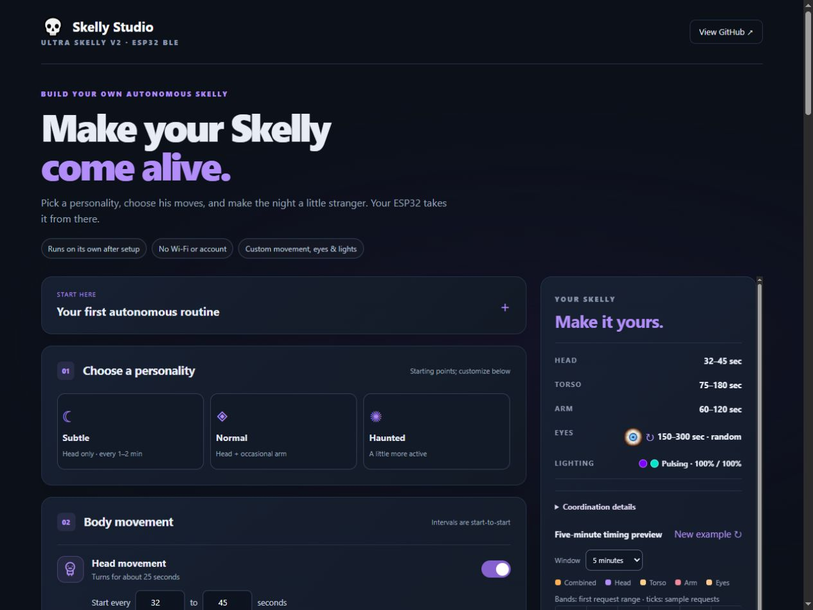
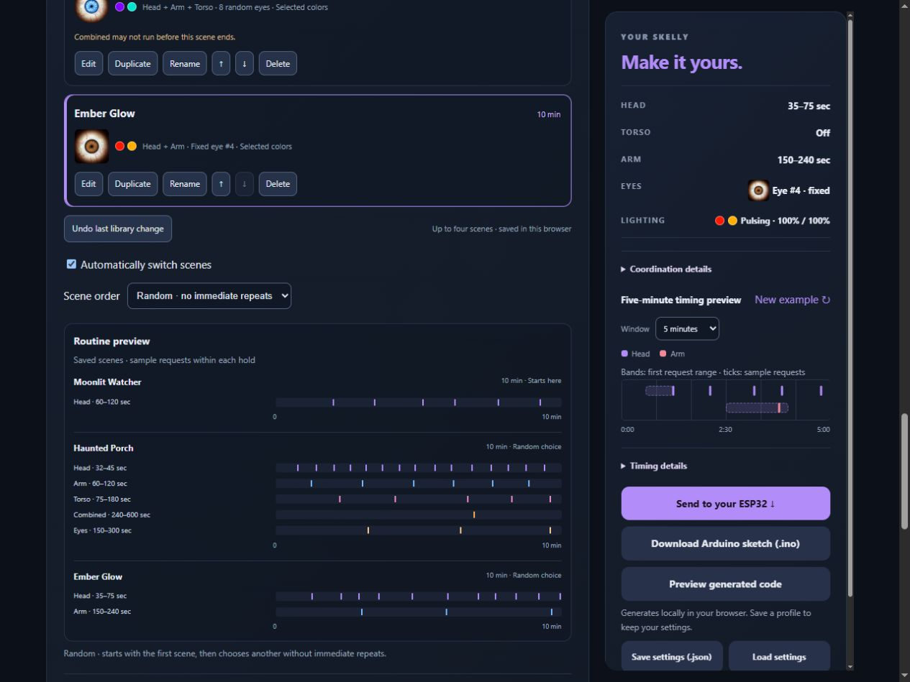
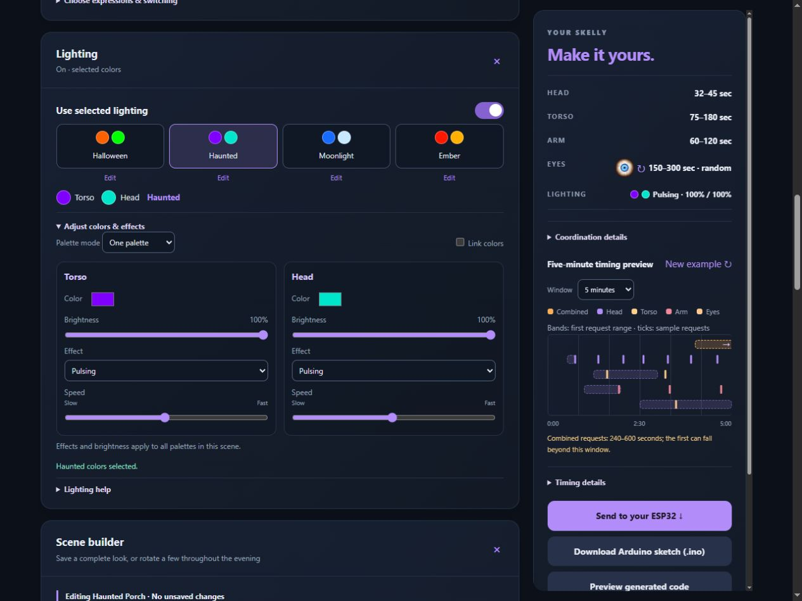

# Ultra Skelly ESP32 Autonomous Controller 💀

Custom, scheduled routines for the Home Depot Ultra Skelly v2, running autonomously
on an ESP32: head, arm and torso movement at your own intervals, optional eyes and RGB.
Configure it
in **[Skelly Studio](https://jacobmgoodnight.github.io/ultra-skelly-esp32-autonomous/studio/)**,
flash an inexpensive ESP32-WROOM board, and let it run without a connected phone,
browser, Wi-Fi, cloud service or subscription.

For Ultra Skelly v2 owners who want occasional movement without keeping a phone
connected. Custom configurations download as Arduino source. An optional
[universal firmware](docs/usb-settings-scenes.md) adds USB settings updates and
up to four saved scenes: compile/install once, then change routines from Studio.
Separate USB tools accept reviewed head-only or universal build packages.
The owner confirms USB connection, reading/saving settings and observed changed
routines. Power-cycle retention, recovery and physical scene transitions remain
separate checks.
The software is free and MIT licensed; you supply the prop,
an original Bluetooth-capable ESP32-WROOM board, USB power/data cable, and a
computer for the initial Arduino upload. Other prop revisions and ESP32 variants
are not covered by the current hardware evidence.

Want Skelly's head to move on its own every few minutes, even when nobody walks
past? Choose **Subtle**, which defaults to **60–120 seconds**, download
the sketch and flash the ESP32. It requests a head animation at a random point
in that range, repeatedly, while powered and connected to the prop. You choose
the intervals; the ESP32 handles the recurring triggers. Other enabled routines
and safety locks may delay starts.

This adds a recurring schedule in Bluetooth mode without manual DecorPro taps or
waiting for the prop's sensor. **Default scheduling uses fixed or randomized
intervals.** An experimental weekday/time window can limit new routines after
you set local time over USB; it pauses after every restart until time is set again.
The stock sensor mode's active-window timer is a different feature. This project
does not establish compatibility with other props. An unobtrusive Advanced option
offers [experimental 2026 app-controlled 12-foot support](docs/experimental-12ft.md),
**not hardware tested**, with head, eyes and chest lighting only. Ultra remains
the default; older 12-foot models are excluded.

## What you can configure

- Random head intervals, with optional arm and torso movements and
  conservative motor cooldowns.
- Fixed or random eye expressions, torso/head RGB, brightness, Static/Strobe/Pulsing
  effects, custom palettes and palette rotation, without uploaded audio.
- Optional **limited mouth routines**, OFF by default, using your own uploaded clips.
- Separate opt-in jaw-first arm/torso and compound body modes, plus idle breaks.
- Named clip mappings, color palettes and portable JSON settings files.
- Up to four named scenes: duplicate, rename, reorder, undo and recover drafts,
  with ordered or random rotation in universal firmware.
- USB settings readback and connected diagnostics with universal firmware.
- Self-contained `.ino` downloads, generated locally and usable offline.

Treat this as a hobby preview tested on one prop. Start with a simple attended
routine; advanced combinations and long unattended operation need validation on
your own setup. The table below separates physical observations from other evidence.

## Build a complete routine

Start with a personality or a complete look. **Moonlit Watcher** requests a head
turn every 60–120 seconds; **Ember Glow** adds an arm request every 150–240 seconds;
**Haunted Porch** adds torso and combined movements. Every complete look loads
movement, eyes and lighting. Customize it, name it and save it in Scene builder.

Normal selects fixed eye #1. Haunted randomly switches eyes #1–8 every 150–300
seconds. The summary shows a small eye preview and a rotation marker when needed.

Each scene defaults to a 10-minute hold. The small **Routine preview** shows sample
requests within each saved scene; unfinished editor changes are excluded. Ordered
rotation follows the saved list. Random starts with the first scene, then chooses
another without immediate repeats. Holds begin after connection; active actions,
cooldowns and reconnects can extend transitions. These charts illustrate requests,
not predicted physical movement.

Choose a palette or edit your own colors, link head and torso, and optionally rotate
palettes. Effects, speed and brightness apply per channel across that scene. Start
here can collapse; idle breaks, clock settings and diagnostics live under Advanced.
Everyday **Send to your ESP32** controls stay separate: connect, read, save a routine
or save scenes. First-time Arduino installation instructions fold away after setup.

Screenshots show illustrative browser settings, with no hardware connection.

## Current evidence — October 23, 2026

| Feature | Latest result |
| --- | --- |
| Head / arm / torso commands | Physically verified: ~25 / 22 / 25 seconds; arm includes two motions |
| Compound masks `0x03`, `0x05`, `0x06`, `0x07` | All activated the selected motors from one packet, with no MP3 |
| Recurring compound scheduler | Owner reports random combined movements work; detailed interleaving/endurance remains unconfirmed |
| Jaw MP3 → 2 s → arm or torso | Physical overlap verified; protected alternating scheduler logged ~30 minutes without reported mid-session reconnects/skips |
| Jaw MP3 → head at 2 or 10 s | **Failed physically** despite logged writes; use protected standalone head |
| Live one-shot / randomized eyes | Physically verified; MP3 eye restoration still needs observation |
| Live torso/head RGB initialization | Both chosen colors physically appeared |
| Lighting effects / palette rotation | Owner confirms both work; exact channel/speed and integration coverage not enumerated |
| Browser USB connection / read / save | Owner confirms success and physically observed changed behavior |
| Saved-settings retention / recovery / scene transitions | Software coverage; physical confirmation still pending |
| MP3 lighting override | **Observed:** file #13 restored its saved colors |
| Post-MP3 lighting restoration (mode 1) | **Physically confirmed:** red body and green head return after MP3 #13; isolated jaw/lighting setup |
| Garbled Serial Monitor output | Reported near playback/restoration; cause unknown |
| Power-cycle reconnect / multi-day endurance | Automatic retries implemented; complete field verification pending |

All observations are from one prop. Logged BLE writes and compile tests do not
prove actuator response. See the [verification matrix](docs/hardware-verification.md)
for evidence limits and the [experiment history](docs/experiments.md) for chronology.

The latest timing/reconnect corrections have software coverage; their focused
[attended regression](docs/audit-follow-up.md) is still pending. Earlier physical
observations do not establish that this firmware revision passed on the prop.

## Quick start

1. Install Arduino IDE and **esp32 by Espressif Systems 3.3.12**. Select **ESP32 Dev
   Module** for the original ESP32-WROOM-32 board. Serial Monitor uses **115200**.
2. Choose movement, eyes and lighting in Studio and download the self-contained
   `.ino`. Mouth routines are OFF by default, including Normal and Haunted.
   **These direct features need no MP3 upload or web controller.**
3. Power Skelly in Bluetooth mode and disconnect any other controller so the
   ESP32 can connect. If using the checked-in firmware instead of Studio, set
   `MOUTH_ENABLED = false` for an audio-free setup; that reference sketch retains
   its previous head-and-jaw defaults.
4. Compile/upload. The ESP32 finds **Ultra Skelly v2** by name; no MAC entry or
   physical wiring to the prop is needed. It scans up to five seconds, targeting five-second scan starts
   during the first minute (until first connection), then pauses 30 seconds
   after misses/connection failures. Studio exposes both retry settings. A board EN/RESET press can help
   after flashing, but automatic retries are intended for regular operation.

[Full setup](docs/setup.md) · [Troubleshooting](docs/troubleshooting.md)

For a first try, select **Subtle** in Studio. It enables
occasional head movement and disables jaw, arm and torso. To use Studio offline,
download the repository ZIP, extract it, and open `studio/index.html`; keep
all files in the `studio` folder together, including `experience.js`. Initial toolchain installation
is a separate setup step. MP3 preparation is only needed for optional mouth routines.

### Optional mouth routines · limited

The collapsed section at the very bottom of Studio contains clip setup and all
mouth coordination controls. Enable it only if mouth movement is worth the
additional limits: playback can interrupt body movement and replace live eyes
and colors. Protection delays other routines, and clip completion is estimated.
Turning mouth OFF clears jaw-first coordination, fair turns and playback logging,
while keeping your clip numbers, body settings and clock window.

Use the community [Skelly Ultra Web Controller](https://martinecker.github.io/SkellyUltraWebController/)
to upload clips once with saved head/arm/torso flags **`0x00`**, test them and record
their actual file serials. **#12/#13/#14 belong to the original test device.**
The physical volume knob can silence the speaker while the jaw moves; software
volume zero is not equivalent. Disconnect that controller before using the ESP32.
Existing saved Studio profiles retain their explicit mouth setting when loaded.

### Lighting effects

Studio generates **static RGB and brightness** for torso and head, plus optional
selected-palette rotation at your chosen interval. Each channel can also select
**Strobe or Pulsing with speed**. The owner confirms effects and palette rotation
work; exact speed/channel coverage and advanced integration remain unconfirmed.
Static and rotation OFF remain the personality defaults.
The upstream controller lists [Static, Strobe and Pulsing](https://github.com/martinecker/SkellyUltraWebController/blob/main/js/constants.js)
for Ultra Skelly. Effects use direct commands without audio preparation.
Use the [new Studio and lighting checklist](docs/studio-lighting-checklist.md)
before combining these options with motors or mouth playback.

[USB tools](studio/usb.html) capture original serial bytes and set the optional
clock. Its installer accepts versioned, hash-checked head-only or universal build
packages and needs internet to load its pinned installer library. Source downloads
require Arduino compilation. Once universal firmware is installed, use Studio to
read and save custom routines or scenes over USB without recompiling. See
[USB setup](docs/usb-tools.md) and [settings/scenes](docs/usb-settings-scenes.md).

## Conservative movement scheduling

The checked-in sketch enables head and jaw, with torso, arm, eyes, compound mode,
live lighting and verbose diagnostics OFF. Start intervals are start-to-start
requests; motor locks or playback may postpone them. Cooldowns remain head **25+7 s**,
arm **22+10 s**, torso **25+10 s**. Conservative presets reduce motor activity.

MP3 protection defaults ON and includes **head, arm and torso**. It prevents an
MP3 from interrupting active body motion and blocks standalone body commands
while playback is due/active. Proven jaw-first arm/torso follow-ups are deliberate
exceptions. Keep compound mode OFF to retain the alternating jaw-first setup;
Studio rejects selecting both modes. Separate-write body overlap has been removed
after physical interruption reports; Studio always serializes separate commands.

[Body safety](docs/body-movements.md) · [Jaw-first guide](docs/jaw-first-experiment.md) ·
[Compound tests](docs/body-combo-test.md)

## Lighting diagnosis in progress

Channel 0 is **Torso Light**, channel 1 **Head Light**; the exact head LED region
has not been mapped to the mouth. Live colors worked before MP3 playback, which
then reapplied saved purple colors. On October 21 the user confirmed that restore
mode 1 returns both the red body and green head afterward. This verifies the
isolated jaw/lighting setup on one prop, not mode 2 or integration with motors.

The reliability changes honor BLE write failures, add timestamped text and boot/reset
information, and complete all six restore writes before the next MP3. Verbose
mode adds heap, connection and write/queue diagnostics. Playback end is still
**estimated**, defaulting to 21 seconds, with a 500 ms grace before queuing
restoration. Studio accepts conservative per-file estimates for longer clips;
experimental playback observations do not control motor or restoration timing.

**Test reference:** [isolated jaw/RGB settings and pass/fail criteria](docs/testing.md).
Mode 1 color recovery is now visually verified on the test prop. Serial corruption
remains unresolved; the log shows steady connected heap and no reported BLE write
failures during four clips. See the October 21 entry in the experiment log.

## Studio and development

Studio runs entirely in the browser and can also be opened as `studio/index.html`
from a downloaded ZIP. It supports motor intervals, compound masks, jaw file pools,
jaw-first follow-ups, fixed/random eyes, optional idle breaks, custom lighting
palettes/effects, scenes and USB settings read/save. Eye thumbnails and sketch
generation use local assets. Editor and saved-scene timelines illustrate requests;
they do not simulate physical movement.

Studio has no application telemetry, login or server-side settings storage.
Saved scenes and valid recovery drafts stay in this browser; export a JSON copy
for backup or transfer. A controller changes only after an explicit save/upload. The hosted
page and bundled eye previews are served by GitHub Pages, which receives normal
web requests. An extracted local Studio folder works offline. Firmware uses
BLE locally and does not configure Wi-Fi or send data to a backend.

The canonical `.ino` generates `studio/template.js` via
`node scripts/sync-template.cjs`; CI fails if they differ. Checks include generator
and gallery tests, actual firmware C++ with mocked clock/BLE, CRC vectors, canonical
and the full pinned ESP32 3.3.12 generated/diagnostic compile matrix.
Tests do not replace physical observation.

- [Architecture and known limitations](docs/architecture.md)
- [Automated checks and hardware procedure](docs/testing.md)
- [Prioritized roadmap](docs/roadmap.md)
- [Owner requests and community research](docs/community-demand.md)
- [BLE protocol](docs/protocol.md)
- [Jaw audio recipes](audio/jaw-personalities.md)
- [Contributor instructions](CONTRIBUTING.md) and [agent instructions](AGENTS.md)

## Report a bug or suggest a feature

Use [GitHub Issues](https://github.com/jacobmgoodnight/ultra-skelly-esp32-autonomous/issues)
for bugs, setup problems and ideas. Include your board, ESP32 core version,
browser (for Studio), selected settings, expected result and actual result.
For hardware reports, separate visible movement/lighting from serial messages.
Remove device addresses and other private information from logs and profiles.
Pull requests are welcome; see [CONTRIBUTING.md](CONTRIBUTING.md) and run the
[documented checks](docs/testing.md) before submitting a change.

## Credits and license

The [Skelly Ultra Web Controller](https://github.com/martinecker/SkellyUltraWebController)
by martinecker enabled file upload, saved-settings experiments and protocol
research. This is a separately written, unofficial hobby controller, not affiliated
with Home Depot or the manufacturer. Original code, documentation and synthesized
audio use the [MIT License](LICENSE); upstream assets retain their own terms.
