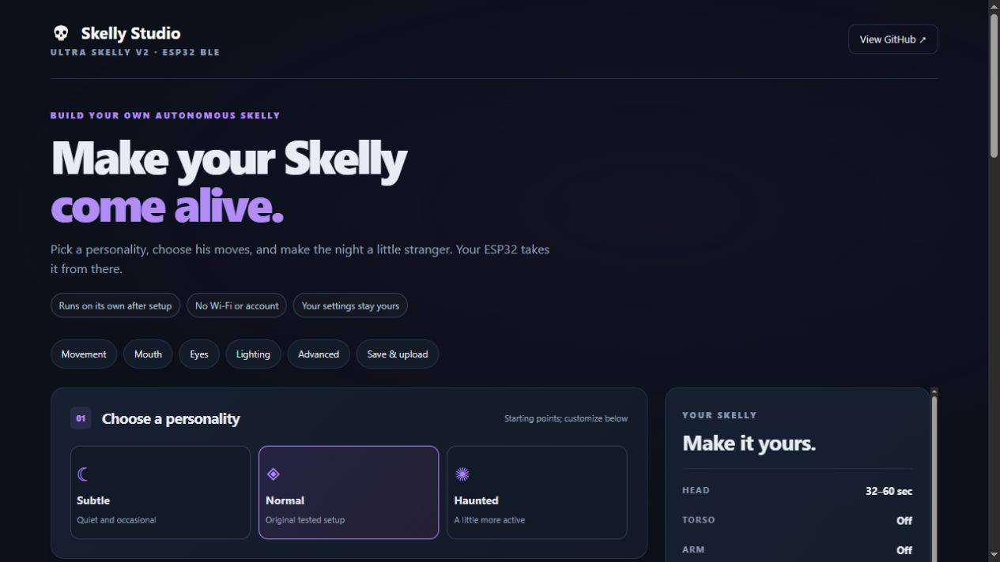

# Ultra Skelly ESP32 Autonomous Controller 💀

Custom, scheduled routines for the Home Depot Ultra Skelly v2, running autonomously
on an ESP32: head movement at your own intervals, jaw clips, optional eyes and RGB.
Configure it
in **[Skelly Studio](https://jacobmgoodnight.github.io/ultra-skelly-esp32-autonomous/studio/)**,
flash an inexpensive ESP32-WROOM board, and let it run without a connected phone,
browser, Wi-Fi, cloud service or subscription. GitHub Pages hosts the static site.

For Ultra Skelly v2 owners who want occasional movement without keeping a phone
connected. Custom configurations download as Arduino source; **Studio does not
upload MP3s or compile sketches**. Separate USB tools can install a fixed head-only
build package. The software is free and MIT licensed; you supply the prop,
an original Bluetooth-capable ESP32-WROOM board, USB power/data cable, and a
computer for the initial Arduino upload. Other prop revisions and ESP32 variants
are not covered by the current hardware evidence.

Want Skelly's head to move on its own every few minutes, even when nobody walks
past? Choose **Subtle**, set the head interval to **120–240 seconds**, download
the sketch and flash the ESP32. It requests a head animation at a random point
in that range, repeatedly, while powered and connected to the prop. You choose
the intervals; the ESP32 handles the recurring triggers. Other enabled routines
and safety locks may delay starts.

This adds a recurring schedule in Bluetooth mode without manual DecorPro taps or
waiting for the prop's sensor. **Default scheduling uses fixed or randomized
intervals.** An experimental weekday/time window can limit new routines after
you set local time over USB; it pauses after every restart until time is set again.
The stock sensor mode's active-window timer is a different feature. This project
does not extend compatibility to the 12-foot app-controlled Skelly or other props.

## What you can configure

- Random head and jaw intervals, with optional arm and torso movements and
  conservative motor cooldowns.
- A mix of your own uploaded jaw clips, optional eye rotations and torso/head RGB.
- Separate opt-in jaw-first arm/torso and compound body modes, plus idle breaks.
- Named clip mappings, color palettes and portable JSON settings files.
- Self-contained `.ino` downloads, generated locally and usable offline.

Treat this as a hobby preview tested on one prop. Start with a simple attended
routine; advanced combinations and long unattended operation need validation on
your own setup. The table below separates physical observations from other evidence.

## Current evidence — October 21, 2026

| Feature | Latest result |
| --- | --- |
| Head / arm / torso commands | Physically verified: ~25 / 22 / 25 seconds; arm includes two motions |
| Compound masks `0x03`, `0x05`, `0x06`, `0x07` | All activated the selected motors from one packet, with no MP3 |
| Recurring compound scheduler | Implemented, OFF by default; extended field testing pending |
| Jaw MP3 → 2 s → arm or torso | Physical overlap verified; protected alternating scheduler logged ~30 minutes without reported mid-session reconnects/skips |
| Jaw MP3 → head at 2 or 10 s | **Failed physically** despite logged writes; use protected standalone head |
| Live one-shot / randomized eyes | Physically verified; MP3 eye restoration still needs observation |
| Live torso/head RGB initialization | Both chosen colors physically appeared |
| MP3 lighting override | **Observed:** file #13 restored its saved colors |
| Post-MP3 lighting restoration (mode 1) | **Physically confirmed:** red body and green head return after MP3 #13; isolated jaw/lighting setup |
| Garbled Serial Monitor output | Reported near playback/restoration; cause unknown |
| Power-cycle reconnect / multi-day endurance | Automatic retries implemented; complete field verification pending |

All observations are from one prop. Logged BLE writes and compile tests do not
prove actuator response. See the [verification matrix](docs/hardware-verification.md)
for evidence limits and the [experiment history](docs/experiments.md) for chronology.

The latest timing/reconnect corrections have software coverage; their focused
[attended regression](docs/audit-follow-up.md) is still pending. Earlier physical
observations do not establish that this firmware revision passed on the prop.

## Quick start

1. Install Arduino IDE and **esp32 by Espressif Systems 3.3.12**. Select **ESP32 Dev
   Module** for the original ESP32-WROOM-32 board. Serial Monitor uses **115200**.
2. With Skelly powered on, use the community [Skelly Ultra Web Controller](https://martinecker.github.io/SkellyUltraWebController/)
   to upload a jaw MP3. Set its saved head/arm/torso movement flags to **`0x00`**.
   Play it once and record its actual file serial. **#12/#13/#14 are specific to
   the original tester's device**, not universal slots. The physical volume knob
   can silence the speaker while the jaw moves; software volume zero is not equivalent.
3. Disconnect the phone/web controller so the ESP32 can connect. Choose settings in
   Studio and download the self-contained `.ino`, or edit
   `firmware/SkellyAutonomous/SkellyAutonomous.ino` and set `MOUTH_FILE_SERIAL`.
4. Compile/upload. The ESP32 finds **Ultra Skelly v2** by name; no MAC entry or
   physical wiring to the prop is needed. It scans five seconds and retries
   misses/connection failures after 30 seconds. A board EN/RESET press can help
   after flashing, but automatic retries are intended for regular operation.

[Full setup](docs/setup.md) · [Troubleshooting](docs/troubleshooting.md)

For a first try without preparing audio, select **Subtle** in Studio. It enables
occasional head movement and disables jaw, arm and torso. To use Studio offline,
download the repository ZIP, extract it, and open `studio/index.html`; keep
all files in the `studio` folder together, including `experience.js`. Initial toolchain installation
and MP3 preparation are separate setup steps.

[USB tools](studio/usb.html) capture original serial bytes and set the optional
clock. A fixed head-only installer uses a versioned, hash-checked build package;
it needs internet to load its pinned installer library. Custom settings still
need Arduino compilation. See [USB setup and evidence limits](docs/usb-tools.md).

## Conservative movement scheduling

The checked-in sketch enables head and jaw, with torso, arm, eyes, compound mode,
live lighting and verbose diagnostics OFF. Start intervals are start-to-start
requests; motor locks or playback may postpone them. Cooldowns remain head **25+7 s**,
arm **22+10 s**, torso **25+10 s**. Conservative presets reduce motor activity.

MP3 protection defaults ON and includes **head, arm and torso**. It prevents an
MP3 from interrupting active body motion and blocks standalone body commands
while playback is due/active. Proven jaw-first arm/torso follow-ups are deliberate
exceptions. Keep compound mode OFF to retain the alternating jaw-first setup;
Studio rejects selecting both modes. Separate-write body overlap remains advanced.

[Body safety](docs/body-movements.md) · [Jaw-first guide](docs/jaw-first-experiment.md) ·
[Compound tests](docs/body-combo-test.md)

## Lighting diagnosis in progress

Channel 0 is **Torso Light**, channel 1 **Head Light**; the exact head LED region
has not been mapped to the mouth. Live colors worked before MP3 playback, which
then reapplied saved purple colors. On October 21 the user confirmed that restore
mode 1 returns both the red body and green head afterward. This verifies the
isolated jaw/lighting setup on one prop, not mode 2 or integration with motors.

The reliability changes honor BLE write failures, add timestamped text and boot/reset
information, and complete all six restore writes before the next MP3. Verbose
mode adds heap, connection and write/queue diagnostics. Playback end is still
**estimated at 21 seconds**, with a 500 ms grace before queuing restoration; there
is no playback-ended subscription. Longer MP3s require a conservative
`MOUTH_CLIP_MS` adjustment in the downloaded sketch.

**Test reference:** [isolated jaw/RGB settings and pass/fail criteria](docs/testing.md).
Mode 1 color recovery is now visually verified on the test prop. Serial corruption
remains unresolved; the log shows steady connected heap and no reported BLE write
failures during four clips. See the October 21 entry in the experiment log.

## Studio and development

Studio runs entirely in the browser and can also be opened as `studio/index.html`
from a downloaded ZIP. It supports motor intervals, compound masks, jaw file pools,
jaw-first follow-ups, eye choices, optional idle breaks, static RGB and sketch
copy/download. Eye thumbnails need internet; generation uses local assets. The
five-minute timeline is illustrative, not a full scheduler simulation.

Studio has no application telemetry, login or server-side settings storage.
Settings remain in the page until you save a JSON profile or sketch. The hosted
page is served by GitHub Pages, and eye thumbnails are fetched from GitHub's
upstream image URLs; those services receive normal web requests. Firmware uses
BLE locally and does not configure Wi-Fi or send data to a backend.

The canonical `.ino` generates `studio/template.js` via
`node scripts/sync-template.cjs`; CI fails if they differ. Checks include generator
and gallery tests, actual firmware C++ with mocked clock/BLE, CRC vectors, canonical
and representative generated ESP32 compilation, and the isolated compound sketch.
Tests do not replace physical observation.

- [Architecture and known limitations](docs/architecture.md)
- [Automated checks and hardware procedure](docs/testing.md)
- [Prioritized roadmap](docs/roadmap.md)
- [Owner requests and community research](docs/community-demand.md)
- [BLE protocol](docs/protocol.md)
- [Jaw audio recipes](audio/jaw-personalities.md)
- [Contributor instructions](CONTRIBUTING.md) and [agent instructions](AGENTS.md)

## Report a bug or suggest a feature

Use [GitHub Issues](https://github.com/jacobmgoodnight/ultra-skelly-esp32-autonomous/issues)
for bugs, setup problems and ideas. Include your board, ESP32 core version,
browser (for Studio), selected settings, expected result and actual result.
For hardware reports, separate visible movement/lighting from serial messages.
Remove device addresses and other private information from logs and profiles.
Pull requests are welcome; see [CONTRIBUTING.md](CONTRIBUTING.md) and run the
[documented checks](docs/testing.md) before submitting a change.

## Credits and license

The [Skelly Ultra Web Controller](https://github.com/martinecker/SkellyUltraWebController)
by martinecker enabled file upload, saved-settings experiments and protocol
research. This is a separately written, unofficial hobby controller, not affiliated
with Home Depot or the manufacturer. Original code, documentation and synthesized
audio use the [MIT License](LICENSE); upstream assets retain their own terms.
