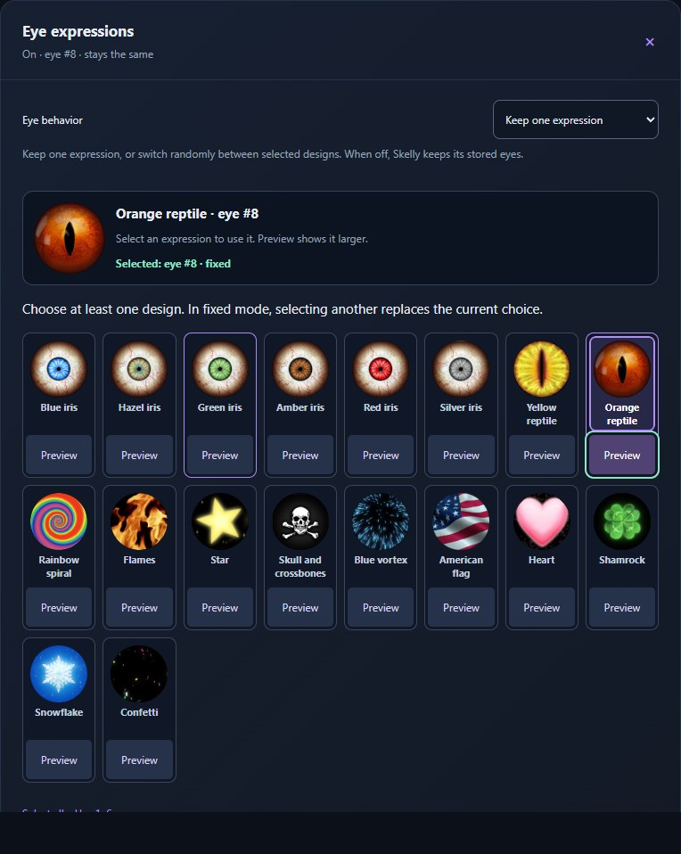
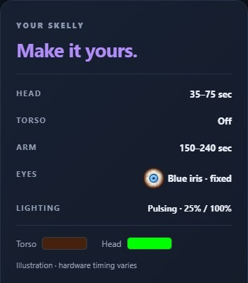
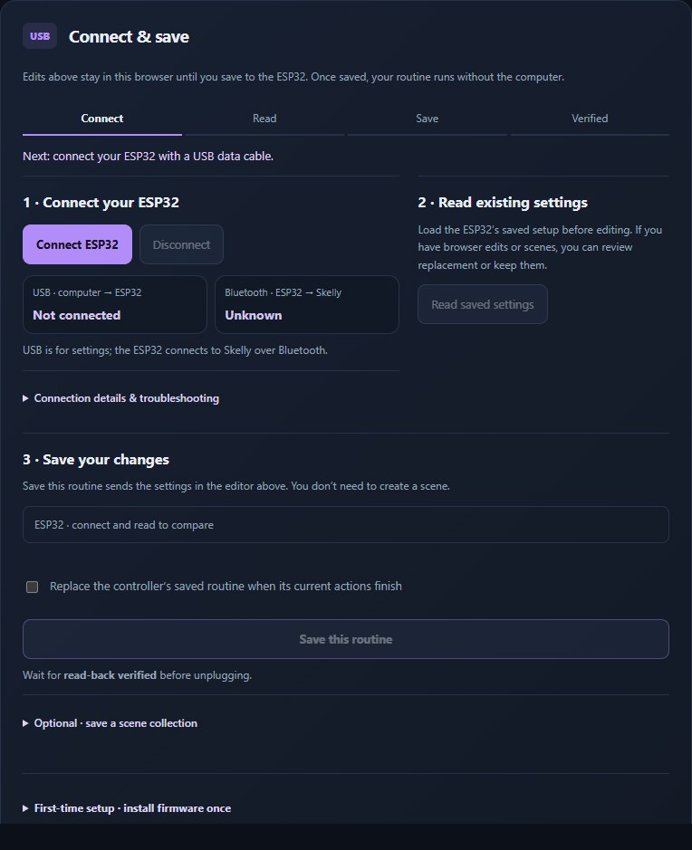
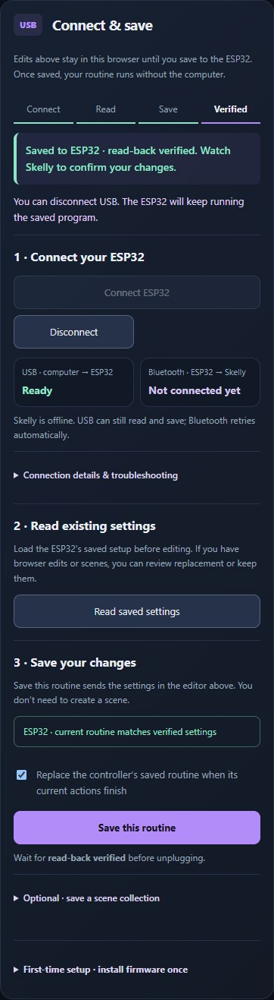

# Skelly Studio appearance and save refinements

October 25, 2026. This follow-up keeps the existing static Studio and hardware
configuration formats. All new evidence is **Software-only**. No firmware,
cooldown, BLE/USB command, default or stored configuration format changes.

## Appearance editing

The redundant Look panel is removed. Eyes and Lighting use the full editor width;
the torso/head controls sit beside each other where space permits. The gallery
uses 64 px artwork and an automatic responsive grid, with descriptive names,
visible selection, keyboard selection and separate 44 px enlarged-preview buttons.
All 18 Ultra expressions remain available. Numbering and unavailable artwork for
the experimental 12-foot model remain unchanged. Artwork attribution remains in
[the eye assets README](../studio/images/eyes/README.md).

Your Skelly keeps the eye summary and now shows a small lighting sample directly
under Lighting. Each supported channel independently reflects color, brightness,
effect and speed. Static stays still; Pulsing and Strobe reuse the existing bounded
opacity animation. Strobe is capped at two browser flashes per second. Reduced
motion and hidden tabs stop animation; the local Pause/Resume button also keeps
samples still through further edits. No preview opens USB or Bluetooth.

The sample deliberately shows only the starting palette during rotation. It says
“Illustration · hardware timing varies”; simulating a whole rotating program would
add complexity and imply timing precision that the hardware evidence does not
establish. A static screenshot cannot show the animation.

## Everyday Connect & save

Three numbered groups follow the workflow: connect, read existing settings, save
changes. Connect and Read sit beside each other on wide screens and stack on
phones. A small progress strip, next-action hint and button emphasis explain the
current step. Connecting never automatically reads or writes settings.

Save this routine remains the primary save. A scene is unnecessary. The optional
scene-collection disclosure explains that it sends the saved browser library,
excluding unfinished editor edits. Browser edits, browser scenes and ESP32 storage
are described separately. First-time installation and connection details have
their own disclosures; incompatible firmware still reveals setup automatically.
USB and Skelly Bluetooth statuses remain distinct, including the ability to save
over USB while Skelly is offline.

The existing replacement checkbox, model/capability checks, serialized transactions
and matching read-back are retained. There is no automatic flashing or saving and
no additional required confirmation. Reading first is recommended, rather than a
mandatory extra step for a new routine. The Verified milestone follows a successful
explicit save and read-back, returns to Save after relevant edits, and resets on a
new USB session. Unverified saves recommend reading before retrying. Explicit
results scroll into view below the navigation; background status never scrolls.

## Validation and limits

- **183 Node tests pass**, including recommended actions, consent, explicit read,
  verified save, edited settings, new USB sessions and failed read-back recovery.
- **18 Playwright workflows pass in desktop Edge**, with a simulated USB controller
  using the real serial parser and transaction code. Checks cover 1440, 768, 390
  and 320 px layouts, open disclosures, keyboard/touch use, 44 px key targets,
  reduced motion, actual opacity animation, independent channels, palette updates,
  pause persistence, offline editing and save/read/error paths.
- **CRC checks, three package tests and the native firmware suite pass** (166
  native PASS messages). Syntax, schema/template sync and asset-version checks pass.
- The repository's complete **Arduino-ESP32 3.3.12** compile matrix is run separately;
  the PR records its final result and the local source-hash manifest is stored at
  `.skelly-build/validation/results.json`.

Screenshots show local browser layouts; controller screenshots use a fixture and
do not show a physical USB/Bluetooth connection. Animation screenshots use reduced
motion so the colors remain visible. Tests add no physical hardware evidence.
Real phones, a dedicated Chrome run, screen readers and first-time-user observation
remain useful follow-ups. Viewport emulation in Edge does not establish those results.
Existing attended hardware checklists remain unchanged.
