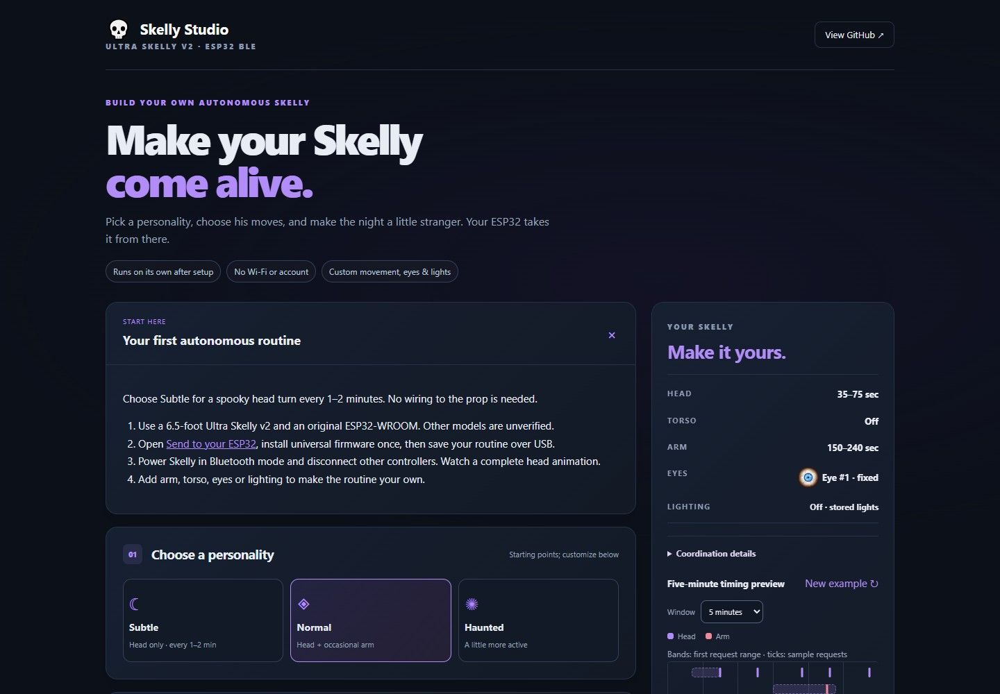
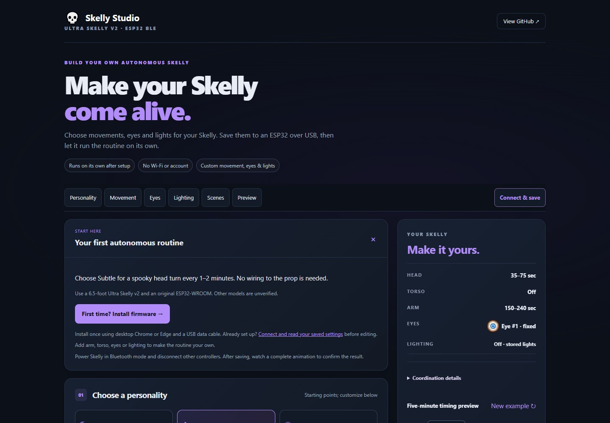
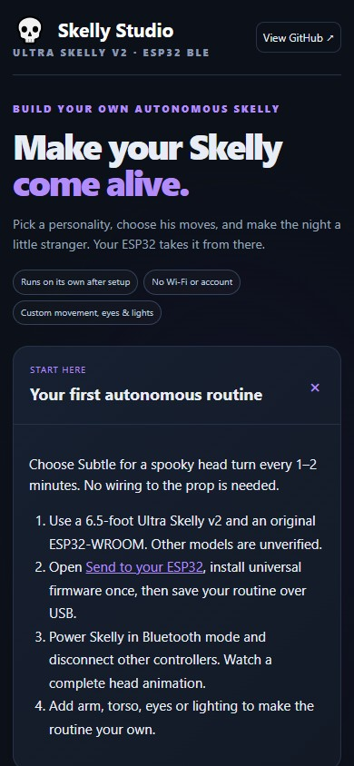
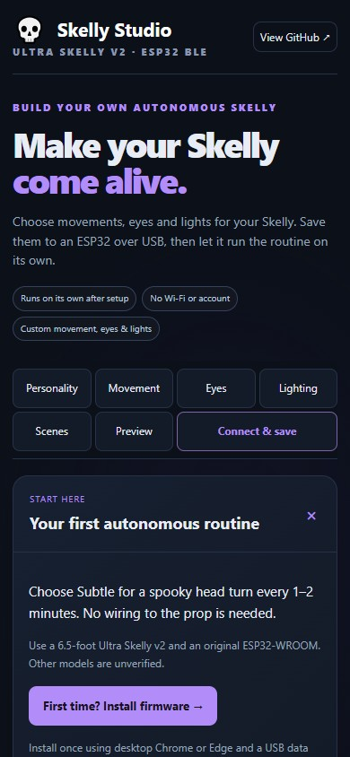

# Skelly Studio usability audit · October 25, 2026

The later [appearance and Connect & save refinement](studio-ui-refinements.md)
updates the gallery, summary lighting sample and everyday save workflow. The
screenshots below document the earlier audit pass.

Scope: the existing static Studio, installer and recovery flows at commit
`07ebc34`. This is an expert review and automated browser evaluation, not a study
with recruited users. All new validation is **Software-only**. No physical USB or
Bluetooth device is opened. Firmware, protocols, cooldowns, presets and saved
profile/scene formats remain in scope for regression checks, not modification.

## What works well

- Three ordinary personalities describe useful starting points. Movement controls
  show duration and intervals; conservative defaults and optional audio remain.
- Local eye images, palette swatches and a bounded sample-request preview explain
  settings without claiming actual motor starts. Saved-scene previews exclude drafts.
- Browser installation is separate from everyday settings saves. USB and Bluetooth
  status are distinct; status age, pending work and verified settings read-back exist.
- Scene edits, imports, Undo and draft recovery protect work. Advanced diagnostics,
  optional audio and experimental model support already use disclosure controls.
- Static hosting, local assets, no accounts and offline sketch generation fit the
  product. Existing save consent and destructive-replacement previews are useful.

## Decisions before implementation

Frequency is an expected workflow frequency, not measured analytics. Complexity
and risk are relative to this codebase. Each change preserves the existing workflow.

| Priority / decision | Finding and user benefit | Frequency | Complexity / risk | Workflow, cognitive load and accessibility |
| --- | --- | --- | --- | --- |
| P1 · Implement | No section navigation. At 390 × 844, Connect/save starts at y=2,906 and Preview at y=4,557. Restore the existing anchor-navigation design so key tasks are directly reachable. | Every visit | Low / low | Same sections; labeled shortcuts, keyboard focus and deep-link disclosure reduce scrolling. |
| P1 · Simplify | The beginner guide sends users to another long panel to find installation. Link straight to the model-specific installer and distinguish install once from everyday saves. | First visit / updates | Low / low | Fewer navigation decisions; no new setup step. Fold guidance after successful identification. |
| P1 · Implement | The verified settings comparison is inside collapsed Scene builder, even for single routines. Reuse it beside USB actions and in the preview. | Every edit/save | Low / low | No duplicate comparison state. Unknown, changed and verified remain distinct and expressed in text. |
| P1 · Implement | Routine validation is distant from USB Save, which remains enabled for invalid edits. Put the existing error beside Save, link it from Preview and disable only the invalid routine save. | Editing/recovery | Low / moderate | Saved-scene sends remain independent of invalid editor drafts; errors remain announced and recovery stays available. |
| P2 · Implement | Small switches, palette Edit, scene Edit and preview buttons; select focus is inconsistent. Raise interactive targets and strengthen focus treatment. | Every visit | Low / low | Keyboard and touch access improve; no extra controls. |
| P2 · Simplify | Advanced model selection can spill outside its panel on phones; small labels and long text need wrapping. Bound fields and retain horizontal scrolling only inside the scene-comparison region. | Mobile / advanced | Low / low | Same settings; no hidden essential actions. Respect reduced motion and test narrow widths. |
| P2 · Simplify | Raw USB chooser/open errors can leave beginners without a next action. Provide short contextual recovery text without automatic retries or writes. | Connection failure | Low / low | Existing explicit connection flow; no new confirmation. |
| P3 · Investigate | Installer carries extensive update/backup guidance and firmware identity details. Test comprehension with beginners before condensing further. | First visit / updates | Moderate / moderate | Avoid removing recovery or overwrite information without evidence. |
| P3 · Investigate | Eye selection versus zoom, and routine versus collection saves, deserve observed usability testing. | Appearance / scenes | Moderate / moderate | Preserve working interactions until real user evidence supports restructuring. |
| Skip | New wizard, tabs, settings dashboard, more personalities, drag-only scene ordering or a new component framework. | — | High / moderate–high | Adds state, dependencies or accessibility costs without establishing a better workflow. |
| Skip | Automatic reads/saves, removing replacement consent, exact physical timeline predictions or altering motor scheduling. | — | Moderate / high | Would change trusted behavior or overstate hardware evidence. |

## Validation and before/after

Baseline: 170/171 Node tests passed. The remaining encoder provenance failure was
caused by checkout CRLF conversion: all four affected files matched their recorded
hashes after restoring LF. This creates no tracked vendor change. The final Node
suite passes **174/174**, including new comparison, validation and recovery cases.

### Review of everyday and advanced controls

| Area | Assessment and selected response |
| --- | --- |
| Information architecture | Existing section order is coherent. Persistent section anchors remove repeated long scrolling without introducing tabs or changing panel ownership. |
| First-time setup | Keep board/browser requirements and Bluetooth-mode guidance visible. Direct installer link removes the intermediate search through USB setup. The installer still explains overwrite/backup and explicit completion. |
| Returning users | Connect/read stays explicit; identifying capable firmware folds introductory guidance. No new setup steps or automatic replacement of browser work. |
| Personalities and movement | Preserve the three ordinary starting points and precise interval inputs. Larger captions improve readability. Selected personality is announced with `aria-pressed`; save consent and preview-window changes no longer falsely clear selection. |
| Eyes | Fixed/random controls, bundled previews and separate zoom work well. Keep selection and preview separate; test their comprehension with users before changing them. |
| Lighting | Existing palette buttons, independent brightness/effects, linked colors and rotation are adequate. Increase palette Edit targets; preserve exact saved values and OFF behavior. |
| Timing preview | Preserve sample requests, five/fifteen-minute windows and explanations of delays. Add direct navigation on narrow screens; never imply physical starts or exact synchronization. |
| Scenes | Explicit Edit/Update/Save as new, Undo, safe replacement and keyboard ordering already work. Clarify optional browser storage versus sending the collection. Preserve all formats and comparison/timing tools. |
| USB saves and system status | Keep separate USB/Bluetooth indicators and firmware/build identity. Expose the existing comparison outside Scene builder. Validate beside Save, clear obsolete verification before writes, and avoid claiming success before matching read-back. |
| Installation/updates | Preserve browser-first installation, model-specific packages, backup guidance and Arduino/local-package fallback. No flashing or package logic changes. |
| Optional audio | Keep both advanced audio-scene preparation and legacy mouth controls available, OFF/collapsed by default. Their distinct evidence and compatibility do not justify combining them in this pass. |
| Experimental model | Keep deliberate opt-in and explicit Untested labeling. Fix selector bounds; both install links follow the current model. No firmware or capability change. |
| Recovery/accessibility | Explicit cancellation/open/save guidance, retained keyboard focus, a skip link, larger targets and reduced-motion checks improve access. No automatic write retries or extra confirmations. |

### Practical changes

| Before | After |
| --- | --- |
| On a 390 px screen, USB/save begins around y=2,906 and Preview around y=4,557; no section shortcuts. | Visible Connect & save and Preview shortcuts reach their existing panels in one action. The navigation remains available while scrolling. |
| Beginner guide links to another panel to find installation. | Direct model-specific First time? Install firmware link; existing users can jump to connect/read. |
| ESP32 comparison is hidden inside Scene builder. | USB actions and Preview show the same comparison; unknown, verified and changed remain distinct text states. |
| Invalid editor settings leave USB Save enabled; the error is distant on phones. | Save this routine is disabled and the existing error is beside it, with a link from Preview. A valid saved collection remains sendable. |
| Prior comparison can survive an unsuccessful save/read-back. | Retire it before the write and require a fresh verified read-back. Failure explicitly recommends reading settings before retrying. |
| 27 px switch hit area, small palette/scene Edit and preview targets; selected personality only has visual styling. | At least 44 px key targets, consistent select focus and announced preset selection. Optional primary-button contrast is slightly strengthened (white on `#8055c0`). |

Screenshots show the same initial Normal configuration at identical viewport sizes,
with no connected controller. They are browser captures, cropped to the viewport;
they are not hardware evidence. The established dark/purple identity, cards and
two-column desktop layout remain.

| Desktop · before | Desktop · after |
| --- | --- |
|  |  |

| Mobile · before | Mobile · after |
| --- | --- |
|  |  |

### Software validation

- **174 Node tests pass.** Generator constraints, imports, scenes, runtime encoding,
  serial transactions, audio, installer and status regression coverage is retained.
- **12 real-browser workflow cases pass** using Playwright and desktop Edge. Tests
  use the real page and serial transaction/parser code with an in-browser USB mock.
  Beginner, returning, personality, scene collection and recovery paths all run.
  Scene CRUD/order/send is tested at desktop and phone widths. Browser scene
  persistence on reload is checked separately from simulated controller storage.
- **Responsive/accessibility checks pass** at 1440 × 1000, 768 × 1024,
  390 × 844 and 320 × 740, including open disclosures and installer pages: no
  page-level horizontal overflow, target bounds, keyboard skip/focus, touch section
  navigation, nested deep-link disclosure, reduced motion and 44 px key targets.
  The saved-scene comparison intentionally retains its own labeled scroll region.
- **Native C++ behavioral runner passes** (166 PASS assertions/messages), executing
  actual firmware with mocked BLE, serial and time. **CRC vectors and all three
  prebuilt/package Python tests pass.** Schema, template, syntax and asset-version
  checks pass; generator substitutions and generated sources remain unchanged.
- The required **Arduino-ESP32 3.3.12 complete matrix has 79 builds**, including
  canonical, generated profiles, compound diagnostics, attended packs and universal
  seeds. Final compilation results are recorded in the pull request and the local
  `.skelly-build/validation/results.json` source-hash manifest.

Reproduction commands and the optional browser runner are in [testing.md](testing.md).
Playwright is test tooling only; no new frontend dependency or service is introduced.
The standalone browser runner is not added as a mandatory CI dependency in this pass.

### Limits and intentionally skipped changes

Viewport emulation in desktop Edge is not a real phone, Safari or Firefox test.
Keyboard, labels, focus, target sizes and representative colors were checked;
this is not screen-reader certification or a complete WCAG conformance claim.
No user study or measured task-completion/satisfaction result is claimed. No
physical flashing, USB/Bluetooth session, power-cycle retention, scene transition,
motor, eye, audio or lighting result is added to the hardware matrix.

Preserved: all existing advanced controls and downloads, JSON formats/storage keys,
safe confirmations, firmware, BLE/USB protocols, schedules and conservative defaults.
Skipped: a wizard, new tabs/presets, component framework, auto-save/auto-read,
drag-only ordering, exact motor simulation, and merging distinct audio workflows.
The longer installer backup wording is retained because an update erases stored
settings; shortening it needs comprehension evidence.

## Next three worthwhile checks

1. Observe a few first-time users completing install discovery, personality choice
   and save without documentation. Check whether install versus save and eye
   selection versus zoom are understood before changing the structure further.
2. Run an actual screen reader and real mobile/Safari/Firefox pass, including
   zoomed text and dialog recovery. Use those observations to target remaining
   accessibility work rather than claiming coverage from viewport emulation.
3. Complete the existing [attended browser-install checklist](browser-installation.md#short-attended-hardware-checklist)
   and [settings/scene checks](usb-settings-scenes.md). Require observed flashing,
   verified read-back and retention, then separately observe safe movement/scene
   transitions. Software acknowledgments cannot satisfy the physical criteria.
