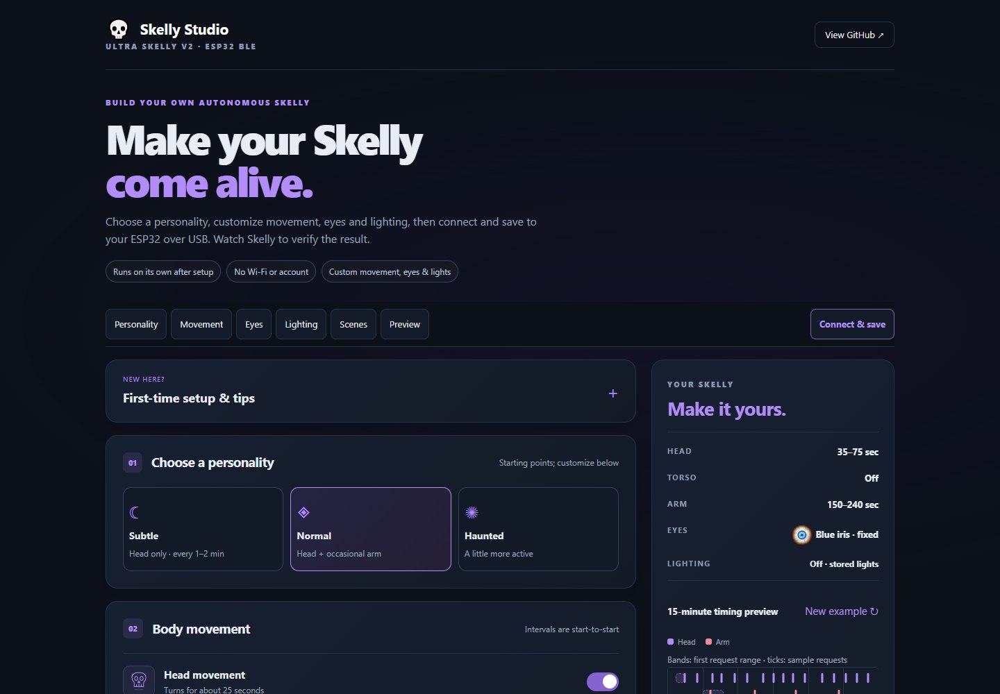
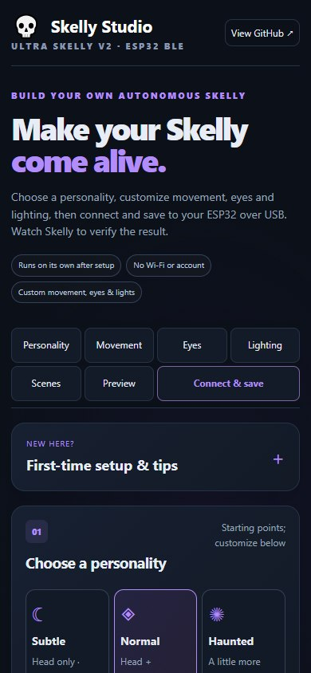
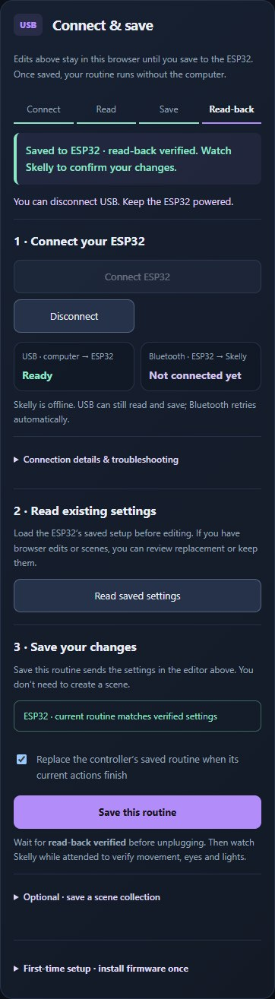

# Studio workflow refinement

This focused pass builds on the [earlier UX audit](studio-ux-audit.md) and
[appearance and save refinements](studio-ui-refinements.md). Section shortcuts,
the eye gallery, illustrative movement and lighting samples, Scene builder, and
Connect & save already existed; they remain in place.

The opening now describes the journey from personality through customization,
USB save and visual verification. First-time setup remains available in a compact
disclosure. Combined body movement settings are grouped under Advanced within
Movement, with their On/Off state visible even when collapsed. The ESP32 comparison
calls out local editing and changes not yet sent when it has a verified baseline.
The final USB milestone is labeled Read-back, and the save guidance asks the user
to observe the prop separately. No USB command, firmware setting or format changed.

| Desktop | Phone |
| --- | --- |
|  |  |

Screenshots and browser checks are **Software-only**. The read-back image uses a
simulated USB controller; it is not evidence of a physical connection or animation.
Desktop Edge viewport emulation does not replace a real phone or screen reader test.
The existing [attended settings checklist](usb-settings-scenes.md) covers visual
confirmation. For combined and individual routines, use the focused
[interleaving check](audit-follow-up.md); record observed motor actions separately
from BLE write results.
